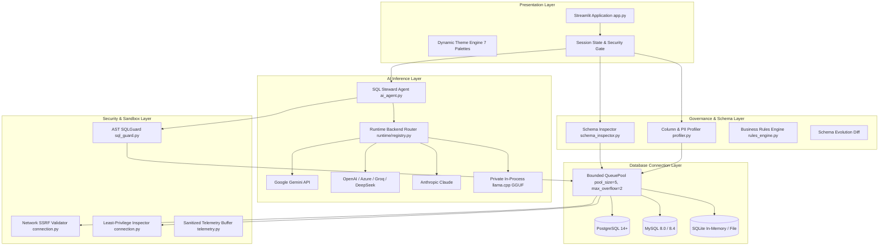

# Architecture Overview

SchemaSense is designed as an enterprise-grade schema governance platform, combining deep relational introspection with dialect-aware Abstract Syntax Tree (AST) query validation and multi-model AI inference.

---

## 1. High-Level System Architecture

SchemaSense follows a clean layered architecture with explicit isolation boundaries between untrusted user inputs, database connection pools, and AI inference runtimes:

---

## 2. Core Subsystems

### A. Presentation & Theming Engine (`app.py`)
- **Framework**: Streamlit 1.39+ with high-performance reactive session state.
- **Theme Palette Engine**: Dynamic CSS injection supporting 7 contrast-compliant palettes (**Obsidian Dark**, **Clean Light**, **Pure White**, **Midnight Charcoal OLED**, **Steel Gray**, **Nordic Slate**, **Deep Ocean Navy**). Theme variables (`--bg-canvas`, `--card-bg`, `--text-primary`, `--border-active`) adapt instantaneously without page reloads.
- **Operator Session Identity**: Header/sidebar identity card displaying authenticated operator credentials, email, and authentication gateway.

### B. Enterprise Connection & Sandbox (`schemasense/connection.py`)
- **Connection URL Building**: Hardened dialect-aware URL constructor preventing parameter injection.
- **SSRF Defense Gate**: Validates target host IP resolution before socket creation, blocking cloud metadata endpoints (`169.254.169.254`), loopbacks (`127.0.0.1`), and link-local subnets unless explicitly enabled in local evaluation mode.
- **Bounded Resource Pooling**: Wraps SQLAlchemy engines with a bounded `QueuePool` (`pool_size=5`, `max_overflow=2`, `pool_timeout=10`), pre-ping connection liveness verification, and safe disposal.
- **Privilege Catalog Auditing**: Non-heuristic inspection querying `pg_roles`/`information_schema` on PostgreSQL and `mysql.user` on MySQL to detect administrative accounts and optionally fail-closed.

### C. AST SQL Guardrails (`schemasense/sql_guard.py`)
- **Dialect Parser**: Powered by `sqlglot`, converting raw SQL text into an Abstract Syntax Tree.
- **AST Node Inspection**: Enforces strictly read-only statements (`exp.Select`). Blocks data manipulation (`INSERT`, `UPDATE`, `DELETE`), schema modification (`DROP`, `ALTER`, `TRUNCATE`), administrative commands (`GRANT`, `REVOKE`, `SET`), and transaction controls (`COMMIT`, `ROLLBACK`).
- **CTE Alias Resolution**: Dynamically tracks Common Table Expression (CTE) definitions and temporary scopes, distinguishing internal query aliases from actual database tables.
- **Allowlist Filtering**: Disallows queries referencing tables outside the verified schema or unauthorized internal schemas (e.g., `pg_catalog`, `information_schema`, `mysql`).
- **Statement Timeout & Row Capping**: Dialect-specific timeout injection (`SET statement_timeout` for PostgreSQL, `MAX_EXECUTION_TIME` optimizer hint for MySQL) and automatic `LIMIT` capping (1,000 rows).

### D. Multi-Provider AI Inference Runtime (`schemasense/runtime/`)
- **Abstract Backend Protocol**: Standardized `BaseInferenceBackend` interface guaranteeing consistent streaming, token usage tracking, and structured output generation.
- **Cloud Providers**: Native implementations for Google Gemini, OpenAI, Azure OpenAI, Anthropic Claude, DeepSeek, Groq, and OpenRouter.
- **Private In-Process Inference**: Native GGUF loading via `llama.cpp` with lazy model allocation, CPU/GPU layer offloading, and zero external egress.
- **Structured Schema Verification**: Validates AI-generated SQL and explanations against Pydantic models with automated schema fidelity checking to flag hallucinated table and column names.
