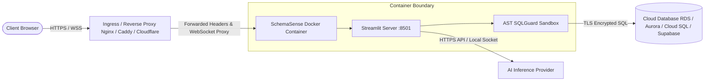

# Deployment & Operations Guide

This guide provides operational patterns and production configurations for deploying SchemaSense across enterprise environments.

---

## 1. Production Architecture Blueprint

In production, SchemaSense runs as a hardened containerized service behind an enterprise reverse proxy or identity-aware gateway:



---

## 2. Nginx Reverse Proxy Configuration

Streamlit requires explicit WebSocket upgrade handling for live UI synchronization. Below is the production Nginx configuration:

```nginx
server {
    listen 443 ssl http2;
    server_name schemasense.internal.company.com;

    ssl_certificate /etc/ssl/certs/schemasense.crt;
    ssl_certificate_key /etc/ssl/private/schemasense.key;
    ssl_protocols TLSv1.2 TLSv1.3;
    ssl_ciphers HIGH:!aNULL:!MD5;

    # Security headers
    add_header X-Frame-Options "DENY" always;
    add_header X-Content-Type-Options "nosniff" always;
    add_header Referrer-Policy "strict-origin-when-cross-origin" always;

    location / {
        proxy_pass http://127.0.0.1:8501;
        proxy_http_version 1.1;
        
        # Mandatory WebSocket upgrade headers for Streamlit
        proxy_set_header Upgrade $http_upgrade;
        proxy_set_header Connection "upgrade";
        proxy_set_header Host $host;
        
        # Forward client IP and identity headers
        proxy_set_header X-Real-IP $remote_addr;
        proxy_set_header X-Forwarded-For $proxy_add_x_forwarded_for;
        proxy_set_header X-Forwarded-Proto $scheme;
        
        # Disable proxy buffering for streaming AI responses
        proxy_buffering off;
        proxy_read_timeout 86400s;
        proxy_send_timeout 86400s;
    }

    # Health check probe
    location /_stcore/health {
        proxy_pass http://127.0.0.1:8501/_stcore/health;
        proxy_http_version 1.1;
    }
}
```

---

## 3. Kubernetes Deployment Manifest

```yaml
apiVersion: apps/v1
kind: Deployment
metadata:
  name: schemasense
  namespace: data-governance
  labels:
    app: schemasense
spec:
  replicas: 2
  selector:
    matchLabels:
      app: schemasense
  template:
    metadata:
      labels:
        app: schemasense
    spec:
      containers:
      - name: schemasense
        image: schemasense:latest
        imagePullPolicy: IfNotPresent
        ports:
        - containerPort: 8501
          name: http
        env:
        - name: SCHEMASENSE_ENV
          value: "production"
        - name: SCHEMASENSE_ALLOW_LOCAL_CONNECTIONS
          value: "0"
        - name: SCHEMASENSE_ACCESS_KEY
          valueFrom:
            secretKeyRef:
              name: schemasense-secrets
              key: access-key
        resources:
          requests:
            cpu: "500m"
            memory: "1Gi"
          limits:
            cpu: "2000m"
            memory: "4Gi"
        livenessProbe:
          httpGet:
            path: /_stcore/health
            port: 8501
          initialDelaySeconds: 15
          periodSeconds: 20
        readinessProbe:
          httpGet:
            path: /_stcore/health
            port: 8501
          initialDelaySeconds: 5
          periodSeconds: 10
```

---

## 4. Production Readiness Checklist

Before moving SchemaSense into live production, verify all checkpoints in `docs/deployment/readiness-checklist.md`:

- [x] **`SCHEMASENSE_ENV` is set to `production`**: Disables local evaluation bypass buttons.
- [x] **SSRF Guard Active (`SCHEMASENSE_ALLOW_LOCAL_CONNECTIONS=0`)**: Blocks private IP and cloud metadata ranges.
- [x] **Read-Only Database Roles**: Connected database accounts have only `SELECT` grants and zero `SUPERUSER` or `ADMIN` roles.
- [x] **SSL Mode Enforced**: Cloud databases configured with `require` or `verify-full`.
- [x] **AST SQLGuard Active**: Verifies queries through `sqlglot` with statement timeouts (5,000ms) and row bounds (1,000 rows).
- [x] **Telemetry Redaction Active**: Eliminates passwords, secrets, and raw SQL literals from in-memory buffers.
