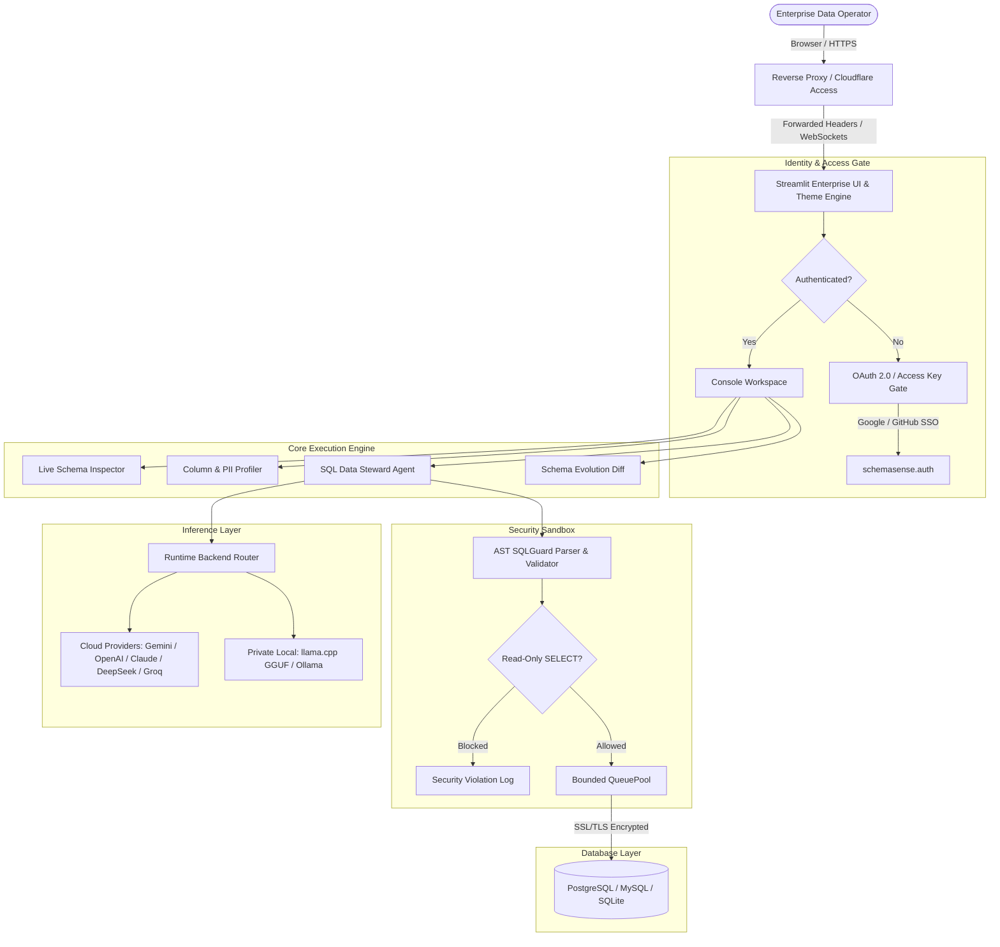

# Welcome to the SchemaSense Wiki

> **Universal Database Intelligence, Enterprise Schema Governance & Multi-Model SQL Agent**

Welcome to the official technical documentation and engineering wiki for **SchemaSense**. This wiki covers architectural blueprints, enterprise security controls, multi-provider LLM integrations, live database configurations, and operational deployment guides.

---

## Quick Navigation

| Section | Description |
|---|---|
| [[Architecture Overview]] | System blueprint, AST pipeline, state management, and component boundaries |
| [[Installation & Setup]] | Environment setup, virtualenvs, local GGUF weights, and initial launch |
| [[Security Model & Access Control]] | AST SQLGuard, SSRF defense, OAuth 2.0 gateway, and least-privilege enforcement |
| [[Supported Databases & SSL]] | PostgreSQL, MySQL, SQLite, and cloud managed SSL/TLS configuration |
| [[Multi-Model Inference Engines]] | Cloud AI (Gemini, OpenAI, Claude, DeepSeek) & local private models (llama.cpp, Ollama) |
| [[Testing & CI-CD Pipeline]] | 420-test multi-tier test suite, Playwright browser tests, Hypothesis fuzzing, and CI |
| [[Deployment & Operations Guide]] | Production readiness checklist, Docker containerization, reverse proxying, and monitoring |

---

## System Architecture at a Glance

---

## Core Capabilities

1. **Deterministic AST SQL Guardrails**: Powered by `sqlglot`, blocking destructive DDL/DML, rejecting comment evasion attacks, preventing schema spoofing, resolving CTE scopes, and enforcing statement timeouts (5,000ms) and row caps (1,000 rows).
2. **Universal Multi-Cloud & Local AI Routing**: Seamless hot-switching between 12+ cloud inference providers and private, offline, in-process quantized GGUF models via `llama.cpp` with zero cloud egress.
3. **SSRF & Network Defense**: Defense-in-depth socket validation preventing server-side request forgery to AWS/GCP/Azure instance metadata services (`169.254.169.254`), loopbacks, and link-local ranges.
4. **Least-Privilege Enforcement**: Active database catalog inspection auditing connected account permissions and blocking superuser or admin credentials from production consoles.
5. **PII & Data Quality Profiling**: Automated detection and risk badging of sensitive entities (credit cards, SSNs, emails, phone numbers, IP addresses) alongside IQR outlier detection and completeness scoring.

---

## Contributing & Development

For local development workflows, branch naming conventions, and pre-commit verification steps, refer to [[Testing & CI-CD Pipeline]].
