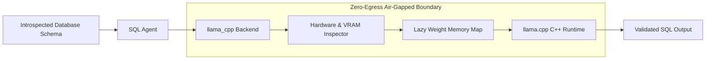

# Multi-Model Inference Engines

SchemaSense features a universal inference architecture that allows data operators to switch between cloud LLMs and fully air-gapped local models with zero vendor lock-in.

---

## 1. Supported Inference Providers

| Provider | Type | Recommended Models | Authentication | Cloud Egress |
|---|---|---|---|---|
| **Google Gemini** | Cloud API | `gemini-2.5-flash`, `gemini-1.5-pro` | `GEMINI_API_KEY` | Yes |
| **OpenAI** | Cloud API | `gpt-4o`, `gpt-4o-mini`, `o3-mini` | `OPENAI_API_KEY` | Yes |
| **Azure OpenAI** | Cloud Enterprise | Custom Deployment (`gpt-4o`) | Azure Endpoint + `api-key` | Yes (Private Tenant) |
| **Anthropic Claude**| Cloud API | `claude-3-5-sonnet`, `claude-3-5-haiku`| `ANTHROPIC_API_KEY` | Yes |
| **DeepSeek** | Cloud API | `deepseek-chat` (V3), `deepseek-reasoner` (R1) | `DEEPSEEK_API_KEY` | Yes |
| **Groq** | Cloud Ultra-Fast | `llama-3.3-70b-versatile` | `GROQ_API_KEY` | Yes |
| **OpenRouter** | Cloud Aggregator | Any listed model | `OPENROUTER_API_KEY` | Yes |
| **llama.cpp** | Local In-Process | Quantized `.gguf` weights | None (runs in-process) | **Zero (Air-Gapped)** |
| **Ollama** | Local Daemon | `qwen2.5-coder`, `llama3.2` | None (`localhost:11434`) | **Zero (Air-Gapped)** |
| **Custom Gateway** | Self-Hosted | vLLM, LiteLLM, TGI, LM Studio | Custom Endpoint + Bearer Token | User-Controlled |

---

## 2. Air-Gapped Local Inference via `llama.cpp`

For organizations with strict data compliance policies that prohibit transmitting schema definitions to external clouds, SchemaSense provides native in-process inference using `llama.cpp` (`schemasense.runtime.backends.llama_cpp`):



### Key Engineering Features of Local Inference:
1. **Zero Cloud Fallback (Fail-Closed Policy)**: If local weights cannot be loaded or dependencies are missing, the backend **fails closed** with a descriptive error. It will never silently fall back to cloud APIs without explicit user consent.
2. **Lazy Allocation**: Model weights are mapped into memory only when the first query is requested, preventing unnecessary memory consumption during initial startup.
3. **Hardware Inspector**: Detects host CPU physical cores, total RAM, and available GPU layers to auto-tune batch sizes and thread allocations.

---

## 3. Schema Fidelity & Hallucination Verification

LLM outputs are strictly guarded against hallucinated table names and columns:

```python
from schemasense.ai_agent import verify_schema_fidelity

# Inspect generated SQL against the verified database schema
fidelity_report = verify_schema_fidelity(
    sql_query=agent_response.sql,
    known_tables=set(st.session_state.db_schema.tables.keys()),
    table_columns=st.session_state.db_schema.get_column_map(),
)

if not fidelity_report.is_valid:
    # Disable one-click query execution button in UI
    # Highlight hallucinated table/column tokens in red warnings
    st.warning(f"Schema Warning: Generated query references non-existent table '{fidelity_report.hallucinated_table}'.")
```

This guarantees that data analysts and engineers are never presented with unverified or syntactically invalid SQL.
