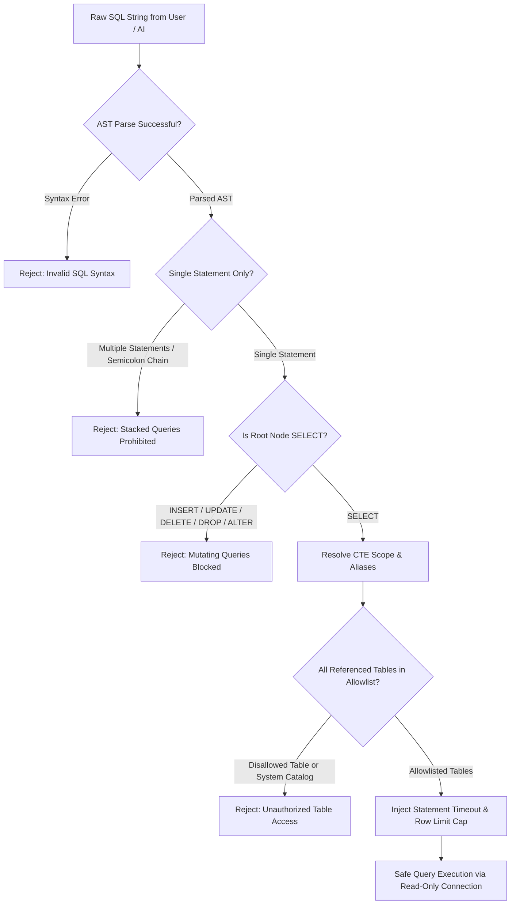

# Security Model & Access Control

SchemaSense implements an enterprise defense-in-depth security model designed to operate safely in zero-trust corporate environments.

---

## 1. Threat Model & Mitigation Matrix

| Threat Vector | Potential Impact | SchemaSense Defense |
|---|---|---|
| **SQL Injection / Destructive DDL** | Data loss, table drops, unauthorized modifications | Dialect-aware **AST SQLGuard** (`sqlglot`) parsing; strictly allows `exp.Select` only. Blocks `DROP`, `ALTER`, `DELETE`, `UPDATE`, `INSERT`, `GRANT`. |
| **Comment & Token Evasion** | Bypassing string-based filters via `--`, `/* */`, or hex encoding | The Abstract Syntax Tree parses comments out of execution nodes, evaluating only normalized AST tokens. |
| **CTE Scope Collision & Spoofing** | Masquerading unauthorized tables as CTE aliases | Scope-aware AST resolver tracks temporary aliases per query branch and validates base tables against verified schema allowlists. |
| **Server-Side Request Forgery (SSRF)** | Accessing cloud metadata (`169.254.169.254`) or internal VPC services | Pre-connect socket resolver checks target IP addresses against RFC 1918, RFC 3927 link-local, and loopback ranges. |
| **Administrative Account Abuse** | Running analytical queries with superuser privileges | Runtime catalog inspection detects administrative roles and flags high-risk accounts; optional fail-closed policy. |
| **Denial of Service (DoS)** | Long-running queries consuming DB CPU and connection locks | Dialect-specific timeout injection (PostgreSQL `statement_timeout`, MySQL `MAX_EXECUTION_TIME`) and bounded `QueuePool`. |
| **Sensitive Data Exposure** | PII and credentials leaking into logs and telemetry | Automated column profiler classification (PCI-DSS, SSN, PII) and sanitized telemetry buffering with literal redaction. |
| **Supply-Chain Compromise** | Malicious or vulnerable dependencies | Automated vulnerability scans (`pip-audit`), CycloneDX SBOM generation, and `detect-secrets` scanning in CI. |

---

## 2. AST SQLGuard Deep-Dive

Rather than relying on vulnerable regex matching, SchemaSense transforms all SQL queries into Abstract Syntax Trees using `sqlglot`:



### Safety Rules Enforced by AST SQLGuard:
1. **Single Statement Invariant**: Semicolon-delimited stacked queries (e.g., `SELECT 1; DROP TABLE users;`) are categorically rejected.
2. **Read-Only Root Assertion**: Only `sqlglot.expressions.Select` root nodes are permitted.
3. **Table & Schema Allowlist**: Every table token in the AST must belong to the active database schema allowlist. Direct references to `pg_catalog`, `information_schema`, or `mysql` tables inside subqueries are rejected.
4. **CTE Scope Tracking**: Temporary aliases defined in `WITH cte AS (...)` are tracked in local lexical scopes and permitted, while unauthorized physical tables within the CTE body are caught and blocked.
5. **Deterministic Row Limits**: Queries without an explicit `LIMIT` clause are capped at 1,000 rows. If an explicit limit exceeds 1,000, it is coerced down to 1,000.

---

## 3. Identity Gate & Authentication

SchemaSense protects the web console using a layered identity gateway:

### A. Zero-Trust Reverse Proxy Authentication
In enterprise deployments behind an identity-aware proxy (e.g., Cloudflare Access, AWS Application Load Balancer, Google Identity-Aware Proxy), SchemaSense inspects trusted identity headers:
- `CF-Access-Authenticated-User-Email`
- `X-Forwarded-User`
- `X-Remote-User`
- `X-Webauth-User`

### B. Federated OAuth 2.0 (Google & GitHub)
Operators can authenticate via standard OAuth 2.0 authorization code flow with state validation and cryptographic nonces.

### C. Enterprise Security Key Gate
When running in standalone mode, setting `SCHEMASENSE_ACCESS_KEY` locks the entire application behind a security key challenge form.

### D. Production Fail-Closed Policy
In production (`SCHEMASENSE_ENV=production`), SchemaSense fails closed:
- If neither OAuth nor `SCHEMASENSE_ACCESS_KEY` is configured, application startup halts with a critical security error.
- Evaluation mode bypass buttons are completely hidden.

---

## 4. Supply-Chain & Vulnerability Policy (Master Checklist S12)

SchemaSense maintains an explicit Vulnerability Exception Registry in `scripts/security_audit.py` to ensure zero unexpected transitive dependencies:

```python
VULNERABILITY_EXCEPTIONS = {
    "pillow": {
        "reason": (
            "Transitive dependency pulled in by Streamlit (<1.60) to maintain "
            "Python 3.10 runtime support. Upstream Streamlit pins pillow<13."
        ),
        "compensating_control": (
            "SchemaSense is a database schema assistant and SQL query generator. "
            "It contains zero image processing, file upload image parsing, or "
            "Pillow API invocations. Pillow code paths are completely unreachable "
            "from user input."
        ),
        "expires": "2027-01-01",
    }
}
```

Any new vulnerability detected by `pip-audit` that does not have an active, documented waiver will cause the CI pipeline to fail immediately.
