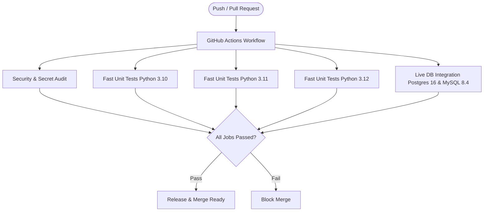

# Testing & CI/CD Pipeline

SchemaSense employs a rigorous multi-tier verification methodology ensuring deterministic security, high test coverage, and multi-version compatibility across Python 3.10, 3.11, and 3.12.

---

## 1. Test Suite Architecture (420 Total Tests)

```
Test Suite Architecture (420 Collected Tests)
├── 1. Fast Unit & Logic Tests (371 Tests)
│   ├── tests/test_ai_agent.py (Fidelity checking, key rotation, response parsing)
│   ├── tests/test_auth.py (OAuth routing, state nonce validation, header extraction)
│   ├── tests/test_backend_selection.py (Multi-provider factory, fallback prevention)
│   ├── tests/test_backends_*.py (Gemini, OpenAI, Claude, DeepSeek, llama.cpp)
│   ├── tests/test_connection.py (URL building, SSRF validation, pool bounds)
│   ├── tests/test_sql_guard.py (AST parsing, CTE resolution, write blocking)
│   └── tests/test_telemetry.py (Data redaction, buffer bounding)
│
├── 2. Property-Based Fuzzing Tests (2 Tests)
│   └── tests/test_sql_guard_hypothesis.py (Hypothesis fuzzing asserting AST invariants)
│
├── 3. Streamlit AppTests (15 Tests)
│   ├── tests/test_ui_apptest.py (9 tests: Connection manager, telemetry, sandbox)
│   └── tests/test_ui_enterprise.py (6 tests: Theme selector, auth gates, eval cycle)
│
├── 4. Real Browser E2E Tests (1 Test)
│   └── tests/test_e2e_playwright.py (Headless Chromium layout and console audit)
│
└── 5. Live Database Integration Tests (43 Tests)
    └── tests/test_live_integration.py
        ├── 17 Live PostgreSQL tests (statement timeout, catalog privilege audit)
        ├── 21 Live MySQL tests (session reset, pool reuse, user grants)
        └── 5 In-process SQLite tests (always execute and pass offline)
```

---

## 2. Running Quality Gates Locally

### Fast Offline Test Suite & Coverage Gate
```bash
# Run all offline-executable tests with 70% coverage threshold:
pytest -m "not docker" --cov=schemasense --cov-report=term-missing --cov-fail-under=70
```
*Current result: **378 passed, 42 skipped, 80.02% code coverage**.*

### Static Typing & Code Formatting Gates
```bash
# Linting check
ruff check schemasense/ app.py tests/

# Formatting check
ruff format --check schemasense/ app.py tests/

# Static type checking
mypy schemasense --ignore-missing-imports
```

### Real Browser Playwright Test
```bash
pytest tests/test_e2e_playwright.py -v
```

### Live Database Integration Suite
Spin up the disposable database containers and execute the integration suite:
```bash
# 1. Start test containers:
docker compose -f docker-compose.test.yml up -d

# 2. Run live integration tests:
pytest -v tests/test_live_integration.py tests/test_ui_apptest.py

# 3. Teardown test containers:
docker compose -f docker-compose.test.yml down
```

### Supply-Chain Security & Secret Scanning Audit
```bash
# Secret leak baseline audit
detect-secrets scan --baseline .secrets.baseline

# Dependency vulnerability audit (Master Checklist S11 & S12)
python scripts/security_audit.py
```

---

## 3. GitHub Actions CI/CD Pipeline

Every pull request and push to `main` triggers 5 automated GitHub Actions jobs in `.github/workflows/ci.yml`:



### CI Job Specifications:
1. **Security & Supply Chain**: Executes Ruff, Mypy, secret scanning baseline verification, and `python scripts/security_audit.py`.
2. **Matrix Unit Tests (3.10, 3.11, 3.12)**: Runs the fast unit tests, AppTests, Hypothesis tests, and Playwright browser tests across all supported Python versions.
3. **Live Database Integration**: Spins up healthy Docker service containers for `postgres:16-alpine` and `mysql:8.4` and runs all 43 live integration tests and 9 live UI AppTests.
